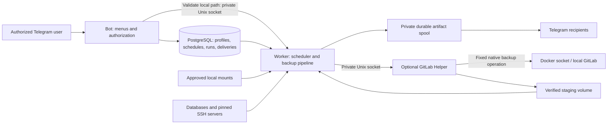

# Backup Telebot

A Telegram control plane and durable background worker for database, filesystem, and
GitLab backups. Configure profiles, schedules, encryption, and recipients through private
Telegram conversations in English or Persian. Docker Compose runs the control database,
bot, worker, and an optional narrowly scoped Local GitLab helper.

**Start here:** [Installation](INSTALLATION.md) · [Operations](OPERATIONS.md) ·
[Security](SECURITY.md) · [Maintainer audit](AUDIT_REPORT.md)

## Capabilities

- Manual, one-time, interval, calendar, and five-field cron schedules.
- Multiple approved local paths or multiple paths on one trusted remote server per file profile.
- Separate archive format and compression settings, with optional Age encryption.
- SHA-256 verification, durable delivery retries, and multipart Telegram delivery.
- Per-profile admin access, superadmin management, run history, cancellation, and retained-artifact retry.
- PostgreSQL control state, transactional scheduling, expiring worker leases, and restart recovery.
- Resource limits, protected runtime files, structured logs, and operational health checks.

## Supported sources

| Source | Acquisition and verification |
| --- | --- |
| PostgreSQL | Custom-format logical `pg_dump`, without native compression; matching-major `pg_restore --list` verification |
| MySQL / MariaDB | Single-database logical dump with routines, events, triggers, and definers; streaming single transaction |
| Microsoft SQL Server | Native full `COPY_ONLY` backup with checksums; compression when supported; `RESTORE VERIFYONLY` |
| Local files / directories | Approved host mounts; traversal and file-change checks; symlinks, special files, and unreadable child entries are skipped and reported |
| Remote files / directories | Host-key-pinned SSH and rsync, with transfer/resource validation |
| SQLite file candidates | Online Backup API snapshot and integrity check; remote snapshots require Python 3 |
| Local GitLab | Native GitLab backup acquired through the optional helper only |
| Remote GitLab | Native backup through pinned SSH, followed by verified rsync retrieval |

Database profiles connect directly to the configured database endpoint. MSSQL writes its
`.bak` on the database server; its configured retrieval path must be visible to the worker
or an assigned SSH server. Running the database in Docker does not grant the worker Docker access.

## Architecture



**Bot:** owns its Telegram session, private menus, short-lived conversation state, authorization,
profile configuration, and operator actions. It never acquires a backup or schedules work in memory.
It is the control plane and has no Local Files / Directories source binds.

**Worker:** polls durable schedules and jobs, claims runs with leases, acquires and verifies
sources, transforms artifacts, and delivers them. One transport owns the worker session;
source acquisition can run concurrently while Telegram sends are serialized for safe client recovery.
It is the backup/data plane and alone mounts ordinary local backup sources.

**GitLab Helper:** optional service for Local GitLab. It alone receives the host Docker socket
and native backup-directory mount. Bot and worker receive neither. The helper accepts a fixed
operation and a validated container name, stages and verifies the native backup, and then
removes that exact native file. The worker independently verifies the staged bytes.

Code boundaries are `application` (use cases), `database` (state/schema), `infrastructure`
(adapters), `pipeline` (execution/recovery), `presentation` (Telegram), and `bootstrap` (process ownership).

## Backup pipeline

```text
Durable queued run + configuration snapshot
  → acquire source → verify source → create archive → compress → optionally encrypt
  → SHA-256 → atomically persist artifact + manifest
  → deliver each required recipient / incomplete part
  → persist success → remove spool after all deliveries resolve
```

Each run uses a UUID-owned workspace under `WORK_ROOT`. Final artifacts and manifests live
under `PENDING_DELIVERY_ROOT`, on the same filesystem for atomic publication. Backup metadata
and history remain in PostgreSQL after successful archive bytes are removed.

A queued run snapshots its source, transform configuration, and assigned admins. Later profile
edits apply to future runs. Delivery still checks live recipient authorization: disabled/deleted
admins and revoked assignments are skipped; enabled superadmins receive all backups.

## Scheduling and Backup Timezone

| Schedule | Activation and subsequent behavior |
| --- | --- |
| Manual | No scheduled cursor; superadmin requests a run |
| Once | One immediate durable due slot when activated |
| Every N minutes / hours / days | Immediate initial run, then elapsed UTC intervals |
| Daily / weekly / monthly | Immediate initial run, then configured wall-clock time; monthly days 1–28 |
| Cron | Next matching occurrence, with no immediate activation run |

Create/Edit and cron re-enabling persist the initial cursor before reporting success. The
worker discovers profiles on each poll. Due-run insertion and cursor advancement commit
together; unique schedule-slot and active-profile constraints prevent overlapping runs.
An occurrence overlapping an active run is recorded as skipped. Missed recurring occurrences
are advanced to a future cursor rather than replayed as a large catch-up queue.

**Backup Timezone** is the application's persisted IANA timezone, initially `UTC`. User-facing
timestamps and calendar/cron interpretation use it; database timestamps remain UTC. Host timezone
does not interpret schedules. Changing it recalculates cron/calendar cursors and preserves
elapsed interval cursors. Cron accepts standard five-field Linux syntax, for example
`15 * * * *`; seconds and extended cron syntax are rejected.

Cron uses timezone-aware croniter calculations. At DST gaps it advances to a valid wall time;
repeated wall times can yield two distinct UTC slots. Validate schedules around DST changes
for your chosen timezone. [Operations](OPERATIONS.md) explains diagnosis of delayed runs.

## Local and remote files

Only explicitly approved roots/mappings can be backed up. `LOCAL_SOURCE_MOUNTS` translates
host paths to worker-visible paths and must match actual Docker bind mounts. Normal file
mounts should be read-only. Runtime, sessions, work, and pending-delivery roots are denied.

The worker publishes a fresh source-path report into shared `DATA_DIR`; the bot displays only
currently approved, available worker paths. Empty path menus commonly mean a missing mount,
wrong mapping, unreadable path, or stale worker report.
During Create/Edit, the bot checks absolute-path syntax and lexical confinement, then requests
filesystem preflight from the worker. Only worker-visible paths (for example `/host/etc`) are
accepted as new input and displayed as copyable `<code>` roots; host mapping paths are not
shown in the prompt. The single `validate_local_source` operation uses a private Unix socket
in the existing shared runtime bind (`LOCAL_SOURCE_VALIDATION_SOCKET`), with 4 KiB messages,
three-second request deadlines, and at most four concurrent requests/filesystem checks.
It returns only validity, a safe reason code, and normalized path/type on success; no contents,
listings, commands, or host paths. Worker unavailability keeps the wizard open for retry.
Every backup revalidates and securely opens sources independently of this preflight.

Remote servers require a private SSH key and explicit host-fingerprint confirmation. Verify
that fingerprint out of band before accepting it. Subsequent connections require the exact
trusted key. Remote file acquisition uses rsync over pinned SSH, without arbitrary command input.

## GitLab

**Local:** enable the `local-gitlab` Compose profile and point `GITLAB_BACKUP_HOST_PATH` at the
native GitLab backup directory on the Docker host. The bot asks for a container name and
shows deployment path information; local profiles do not store an editable native path.
The helper runs the fixed `gitlab-backup create` command, requires exactly one new stable
regular native tar, verifies its staged copy by size and SHA-256, then removes the native artifact.
Its private control/staging volumes are shared only with the worker.

**Remote:** choose a trusted remote server, validated container name, and remote native
backup directory. GitLab's native command runs through SSH; the worker verifies the rsync
copy before removing the exact remote artifact. This mode does not use the local helper.

GitLab application backups omit important machine configuration. Separately protect
`gitlab.rb`, `gitlab-secrets.json`, and any deployment-specific configuration required for restore.
Restore using the matching GitLab version and edition.

## Archive, compression, and encryption

Archive formats: **TAR, ZIP, 7z**. Compression algorithms: **None, Zstandard, Gzip, XZ, Bzip2,
LZ4**, with Fast/Balanced/High/Ultra presets where applicable. Compression threads/memory are
global settings. Native MSSQL compression skips secondary compression. Existing legacy
profile/run compatibility remains supported.

Encryption modes: **None**, **Age recipient public keys**, or **Age passphrase**. Stored source
credentials and Age passphrases use authenticated encryption with `MASTER_ENCRYPTION_KEY_B64`.
That master key protects application secrets; it is not a substitute for retaining the private
Age identity or passphrase needed to decrypt an archive.

## Telegram multipart delivery and recovery

Final files larger than `TELEGRAM_MAX_FILE_BYTES` are split after compression and encryption.
The default part limit is 2,000,000,000 bytes. Names use `.part001`, `.part002`, and so on;
the manifest records the combined checksum and every part's size/checksum.

Delivery progress is persisted per recipient and part. Temporary proxy/TCP/DNS failures,
timeouts, transport disconnections, and retryable server RPC errors schedule another attempt.
The worker retires damaged clients, waits for their shutdown, creates a fresh client against
the same saved session and configured SOCKS5 proxy, and verifies authorization.
Startup network failure leaves the worker operational. Fatal Telethon background-loop failures
are monitored during uploads and surface to durable retry handling.

Successful parts are not resent after their progress commits. An interrupted file/part uploads
again from byte zero; there is no durable byte-offset resume. A crash or lost acknowledgment
between Telegram acceptance and database commit can still produce a duplicate message.

Backoff is exponential with a cap and jitter. Retry timestamps and attempt counts survive
restarts. The default budget is ten attempts **per incomplete part**; invalid recipients,
revoked credentials, and configuration failures stop automatic retries. Exhaustion marks the
run `FAILED` / `DELIVERY_ACTION_REQUIRED`. Correct the cause and use **Retry Delivery** before
retained-artifact expiry. This resumes saved bytes without rerunning source acquisition.
Pending artifacts do not expire; terminal failed artifacts default to seven-day retention.
Cancellation and an explicit operator purge are separate cleanup actions.

Download all parts, then concatenate in filename order before decrypting or extracting:

```bash
cat backup.tar.zst.age.part* > backup.tar.zst.age
age --decrypt --identity /secure/path/identity.txt --output backup.tar.zst backup.tar.zst.age
zstd --decompress backup.tar.zst
```

Validate a checksum from a separately trusted record; the manifest is stored in the spool and
is not automatically sent as a separate Telegram document.

## Access and security

Only configured enabled users can interact in private chats. Superadmins configure the
system, administer users/servers/profiles, and control runs. Normal admins receive assigned
backups and have a limited read-only menu. Callback capabilities are opaque, actor-bound,
expiring, and rechecked against current authorization.

Bot/worker containers run as UID/GID 10001 with a read-only root filesystem,
`no-new-privileges`, all capabilities dropped, and bounded CPU/memory/process counts.
PostgreSQL and helper sockets are not published as network ports. Sessions and runtime state
are private files. Logs retain safe error classes and frame locations without raw exception
messages or local variables. See [SECURITY.md](SECURITY.md) for boundaries and accepted risks.

Telegram bot chats are not end-to-end encrypted. Treat Telegram delivery and secret entry as
part of your trust model; enable archive encryption when appropriate. This is a backup tool,
not an independently certified security boundary.

## Requirements and installation

Use a supported Ubuntu/Linux Docker host, Docker Engine with Compose v2, outbound Telegram
connectivity or a reachable SOCKS5 proxy, Telegram API credentials/bot token, and persistent
storage with sufficient free space. Optional sources need appropriate database/SSH permissions.
The supplied image includes PostgreSQL 15 clients; other server majors require matching clients
in a derived image.

Follow [INSTALLATION.md](INSTALLATION.md) for secrets, runtime ownership, mounts, networking,
and safe update/restore commands. Deployment order is PostgreSQL → migrations → bot/worker,
with the helper enabled only for Local GitLab.

## Operations and limitations

- Keep independent, encrypted copies of the control database, runtime state, and master key.
- Successful artifact bytes are removed from the spool; Telegram recipients or a separate
  backup system must retain the archive for your required retention period.
- Disk/pending-storage backpressure pauses new acquisition while due delivery can continue.
- Logical dumps/native verification do not prove restore success; regularly perform restore drills.
- MySQL consistency depends on transactional tables and avoiding concurrent schema changes.
- General live filesystem copies are not application-consistent snapshots.
- Run one worker for a given saved Telegram session. Use distinct sessions for bot and worker.
- GitLab's Docker socket is host-powerful even behind a narrow helper protocol.

[OPERATIONS.md](OPERATIONS.md) covers health, safe restarts, retry diagnosis, disk usage,
migrations, and release acceptance tests.

## Development and validation

Python 3.12+ and `uv` are supported; the container uses Python 3.13. For development use
`APP_ENV=development`, a private SQLite URL, separate test credentials, and owned runtime roots.

```bash
uv sync --frozen --all-groups
uv run ruff check .
uv run ruff format --check .
uv run mypy src
uv run pytest
uv run bandit -r src
uv run python -m compileall -q src
uv run alembic heads
```

Tests include mock Telegram clients, a real loopback SOCKS5 outage scenario, isolated database
fixtures, and Docker-backed database/SSH/crash coverage when the required daemon/images are
available. They do not require public Telegram connectivity.
